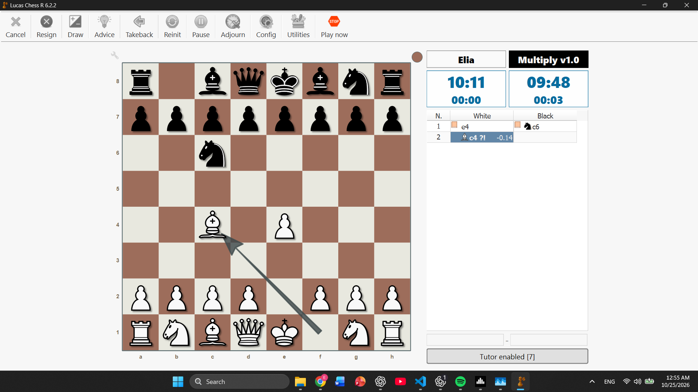

# MultiPLY

MultiPLY is a C++ chess program with terminal play, position analysis, a UCI engine interface, and tools for investigating move generation and search performance.

**Current version: v1.2** The executable is named `MultiPLY.exe`; its UCI identification string is currently `MultiPLY v1.2`.


*Lucas Chess screenshot*

## Features

- Standard chess move generation, including castling, en passant, and all promotions.
- Local and engine games, with optional clocks and increments.
- Replay and branching analysis, with board orientation controls.
- FEN positions, SAN and UCI move notation, and PGN import/export with clock annotations.
- Alpha-beta search with staged move picking, incremental tapered evaluation, timed iterative deepening, mate-distance scoring, and basic clock management.
- A UCI subset for connecting to chess GUIs such as Lucas Chess.
- Perft suites, a Stockfish comparison debugger, search benchmarks, pruning profiles, and Picker Lab experiments.

## Build

The current build targets **64-bit Windows**. The Stockfish bridge and Picker Lab use Windows APIs. Requirements:

- Git, CMake **3.21 or newer** for the supplied presets, and a recent Visual Studio installation with Desktop development with C++ and a Windows SDK.
- A compiler and standard library supporting the C++23 features used here, including `std::expected`, plus `std::format`.
- A vcpkg installation at `C:\vcpkg`. The current CMake configuration forces `C:/vcpkg/scripts/buildsystems/vcpkg.cmake`; no third-party C++ package is declared. To use a different installation, edit that path in both CMake files before configuring. A command-line override alone will not replace the forced value.

Run in PowerShell with CMake available on `PATH`:

```powershell
git clone https://github.com/damianielia-lgtm/Chess-in-CPP.git
Set-Location Chess-in-CPP
cmake --preset max
cmake --build --preset max
.\build\max\Release\MultiPLY.exe
```

These executable paths assume the Visual Studio generator. The build creates `MultiPLY` and the separate `picker_bench`, `book_compiler`, and `match_runner` tools. Release interprocedural optimization is enabled when supported. For a Debug build:

```powershell
cmake --preset debug
cmake --build --preset debug
.\build\debug\Debug\MultiPLY.exe
```

The source declares a CMake 3.20 minimum, but the version-3 preset format requires 3.21+. The `max` preset selects Release; it does not enable a separate set of aggressive optimization flags.

## Run in the terminal

Start the executable without arguments. It opens at `chess>`; enter `help` for the built-in command list or `quit` to close it. Use a terminal supporting ANSI colors and cursor movement.

From the repository root, try:

```text
position --startpos
position show
move e2e4
engine bestmove --depth 3
engine dynamic-eval --time-ms 1000
fen save after-e4
```

The default move notation is UCI coordinates. Switch to SAN with `config set move-notation san`. Play a game with:

```text
play engine --player-color white --time-control 300+2
```

Here `300+2` means **300 seconds plus 2 seconds per move**. Enter moves directly in the game view; use `resign` or `draw` to finish. Then `pgn save first-game` stores the completed game. See the [complete CLI reference](docs/cli.md) for replay, analysis, file management, and all commands.

**Working directory matters:** `data/` and `resources/` resolve from the process working directory. Launching from the repository root uses its resource suites. The build also copies `resources/` beside `MultiPLY.exe`, so launching from that directory works too. The program creates `data/` there and needs write access. Moving only the executable loses access to the suites and optional debugger executable.

## Connect to a UCI GUI

Register `MultiPLY.exe` as an external UCI engine in Lucas Chess or another GUI. No startup arguments are required. Choose a writable working directory and keep the copied `resources/` folder available there if using diagnostics.

The GUI must send `uci` to switch the program from CLI to UCI mode. A minimal manual session is:

```text
uci
isready
position startpos moves e2e4 e7e5
go depth 3
quit
```

The engine replies with its identification, `uciok`, `readyok`, and a `bestmove` line. It also supports `go movetime` and clock-based `go` commands. Searches are synchronous; `stop`, pondering, engine options, and streaming analysis output are unavailable.

## Check move generation

```text
position --startpos
perft test --depth 3
perft test --preset fast
report save perft-fast
```

Start-position depth 3 produces **8,902 nodes**. The preset test compares against stored expected counts. Stockfish is optional and is used only by `debug --depth N`, which expects `resources/stockfish.exe`.

## Current engine strength and limitations

MultiPLY v1.2 provides a simple search baseline with staged move picking and cached evaluation updated as moves are applied. No measured Elo rating is supplied.

| Implemented | Not implemented in v1.2 |
| --- | --- |
| Alpha-beta minimax with staged, scored move picking | Killer/history and principal-variation ordering |
| Iterative deepening for timed searches | Quiescence search |
| Incremental tapered material and piece-square evaluation | Transposition tables |
| Mate-distance scoring | Advanced pruning and search extensions |
| Basic soft/hard time budgets | NNUE, opening books, and tablebases |

Search depth is limited to 16 plies. The search does not track repetition, the fifty-move rule, or insufficient-material draws. The CLI game layer handles those separately, automatically ending games at threefold repetition and 100 halfmoves; its insufficient-material test covers common cases rather than every dead position. Terminal detection occurs after the depth-zero evaluation check, so mates exactly at the horizon can be missed. Fixed-depth searches cannot be interrupted through the interface, and timed limits are approximate. [Engine details](docs/engine.md) explain these tradeoffs.

## Documentation and layout

| Path | Purpose |
| --- | --- |
| [docs/cli.md](docs/cli.md) | Every CLI command and interactive mode |
| [docs/uci.md](docs/uci.md) | Supported protocol, outputs, and compatibility limits |
| [docs/engine.md](docs/engine.md) | Evaluation, search, scoring, and time management |
| [docs/movegen.md](docs/movegen.md) | Movement tables, attack detection, legal moves, and special moves |
| [docs/architecture.md](docs/architecture.md) | Modules, state ownership, and data flow |
| [docs/diagnostics.md](docs/diagnostics.md) | Perft, debugger, benchmarks, profiles, and Picker Lab |
| [docs/match-runner.md](docs/match-runner.md) | Opening-book compilation and paired UCI engine matches |
| [docs/file-formats.md](docs/file-formats.md) | Managed files, configuration, PGN/FEN, EPD, and CSV |
| `src/core/`, `src/movegen/` | Position representation, attacks, and legal moves |
| `src/game/`, `src/notation/` | Game history, clocks, results, and notation |
| `src/engine/`, `src/interface/` | Search/evaluation and CLI/UCI frontends |
| `src/storage/`, `src/diagnostics/`, `src/picker_lab/` | Persistence and development tools |
| `resources/` | Input suites and optional external Stockfish executable |
| `data/` | Generated local configuration, saved games, positions, and reports |
| `build/` | Generated build output |
| `versions/` | Local historical material; not a build input |

## Project history and roadmap

MultiPLY began as a Python chess program, was rebuilt from scratch in C++, and evolved into a standalone engine with a UCI interface. Version 1 records the working chess program and its deliberately simple search as a baseline for future experiments.

Version 1.1 added move ordering using capture, promotion, and piece-square scores. Version 1.2 replaces eager scored lists with a staged move picker and tracks evaluation incrementally in each position. Future directions include fixing UCI FEN loading, interruptible search and richer UCI output, further move-selection experiments informed by Picker Lab, quiescence search, transposition tables, stronger evaluation, and broader platform support. These are directions, not scheduled release commitments.

## License and attribution

Author: **Elia Damiani**, as identified by the engine. No project license file is currently supplied; this documentation does not assign a license.

Stockfish is an external reference tool for the debugger, not the engine that chooses MultiPLY's moves. It is not tracked in this repository. Keep any separately distributed Stockfish binary with its own license and attribution materials. The supplied evaluation tables and perft suites have no provenance notes in the source; their attribution remains to be recorded before release.
