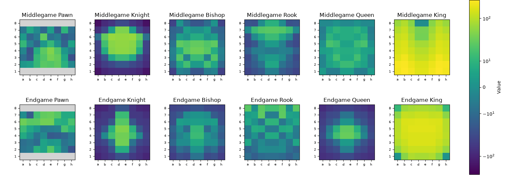
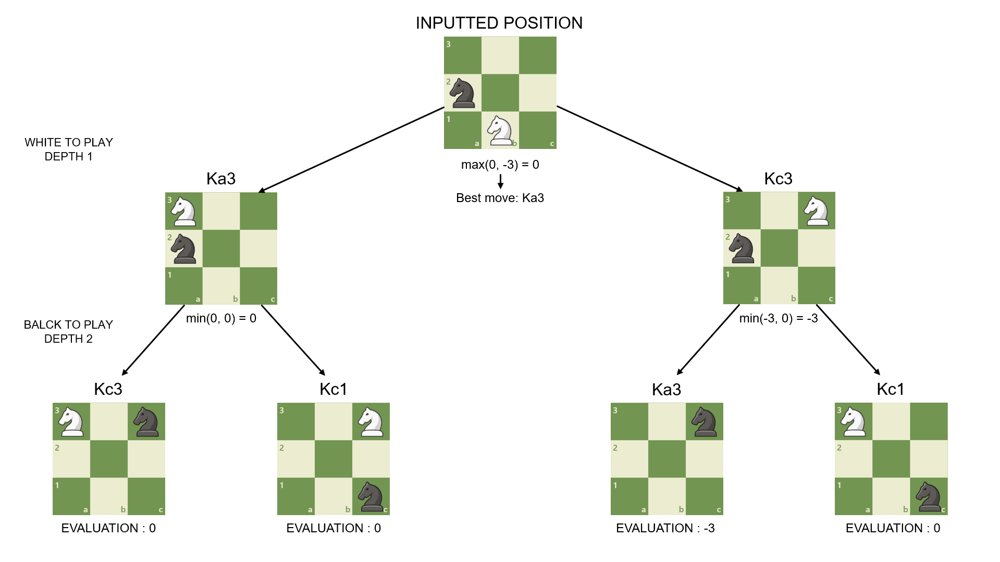
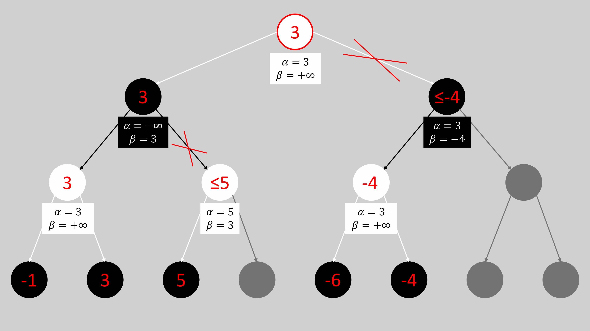

# Engine baseline — MultiPLY v1.2

[README](../README.md) · [Architecture](architecture.md) · [Move generation](movegen.md) · [Diagnostics](diagnostics.md)

Version 1.2 is a simple, single-threaded baseline: incremental tapered static evaluation, minimax with alpha-beta pruning and staged move picking, mate-distance scoring, and iterative deepening for timed searches. Picker Lab separately studies move-selection costs; search uses the staged policy described below.

## Static evaluation

Each `Position` caches material phase and material-plus-piece-square totals for both middlegame and endgame. White's contributions are positive and Black's negative. Material and square terms are combined in precomputed lookup tables. `Position::static_eval()` blends the cached totals without scanning the board.

The starting position initializes phase to 24 and both totals to zero. FEN construction calls `get_static_eval(position)` to scan the board and initialize a `StaticEval` containing the raw phase and both totals. `apply_move()` then updates only the affected contributions: the moving piece's origin/destination, captured material (including the en passant capture square), promotion replacement, and the castling rook's movement. `UndoState` saves the prior totals and phase for `revert_move()` to restore. Lightweight `make_move()`/`unmake_move()` used for legality tests change only placement; cached evaluation must not be read while such a temporary board change is active.


*Piece-squate table Heatmap*

Game phase is the sum of remaining piece weights: knight/bishop 1, rook 2, queen 4, pawn/king 0. The cached phase retains the raw sum as captures remove weights and promotions add them; `Position::phase()` and static evaluation clamp it to 24. Evaluation blends with integer arithmetic:

$$
\text{Score} = \frac{\left((\mathit{PV}_{\mathit{MG}} + \mathit{PSQT}_{\mathit{MG}}) \times P\right) + \left((\mathit{PV}_{\mathit{EG}} + \mathit{PSQT}_{\mathit{EG}}) \times (P_{\max} - P)\right)}{P_{\max}}
$$

There are no separate mobility, pawn-structure, king-safety, or neural-network terms. Piece-square tables supply positional preferences. A positive score always favors White, irrespective of whose turn it is.

Internal units are not normalized centipawns. The average middlegame/endgame pawn material value is 167 internal units; the conversion helper returns `score * 100 / 167`, with integer truncation. All top-level outputs apply this conversion.

## Fixed-depth search

The root and recursive non-leaf nodes request legal moves from a `MovePicker` in promotion, capture, then quiet stages. For each move, search applies it to one mutable position, recursively evaluates the child, then restores the position with its undo record before requesting the next move. White maximizes and Black minimizes the evaluation. Alpha and beta are updated as children complete; a node stops searching siblings when `beta <= alpha`, avoiding generation of any stages it has not reached.




*Alpha-beta pruning: white nodes maximize and black nodes minimize; gray branches are skipped after a cutoff. After the left subtree establishes a root score of 3, the right MIN node can stop once a child returns −4, since its result cannot improve the root's choice. In the left MAX subtree, seeing 5 establishes a lower bound of **at least 5** and triggers a cutoff against beta = 3; the diagram's `≤5` label should read `≥5`. Crosses indicate cutoffs within those subtrees, rather than moves skipped before any child was searched.*

The requested depth counts plies including the root move. A depth-1 search statically evaluates each resulting position. The implementation checks depth zero **before** generating legal moves, so terminal detection is absent at that boundary. Checkmate or stalemate exactly on the horizon can be evaluated statically instead of as a terminal position.

At nonzero remaining depth, no legal moves means checkmate when the king is attacked, otherwise stalemate. Stalemate scores zero. Mate uses magnitude `32766 - ply`, negative when White is mated and positive when Black is mated. This favors faster wins and delays unavoidable losses. Infinity is 32767. CLI output does not translate this to `mate N`.

At the root, equal search evaluations retain the first encountered best move. Each iteration regenerates heuristic ordering; previous iterations do not supply principal-variation ordering. `engine rank` enumerates its root moves with the unscored generator, searches each with an independent full window and recursive staged pickers, and sorts the resulting evaluations for the side to move. This costs more than sharing a root alpha-beta window, but avoids presenting sibling cutoff bounds as independent exact scores. Equal-score ranking order is not guaranteed.

Fixed-depth requests perform one search, without iterative deepening or a time limit. CLI/UCI depths are restricted to 1–16; the move-list stack holds 16 plies and each list has capacity 256. High depths can still take a very long time.

## Move ordering

Ordering scores are separate from search evaluations. `MovePicker` gives promotions priority over non-promotion captures, then quiet moves (including castling), regardless of scores in other stages. Both colors consume higher ordering scores first within a stage.

Each stage buffers scored pseudo-legal candidates only when needed. Until the first legal move is returned, `next_move()` uses `std::max_element` to select a candidate and replaces its slot with the last buffered entry. Illegal candidates are discarded and selection continues. After that first legal move, the remaining candidates in each stage are sorted once in ascending score order and consumed from the end. Legality is tested only when a candidate is selected. A cutoff after the first move can therefore avoid sorting and later-stage generation. Equal-score consumption order is not guaranteed.

| Move | Ordering score |
| --- | --- |
| Capture, including en passant | MVV-LVA: `10 * victim_value - attacker_value`, using each piece type's average middlegame/endgame material value. En passant uses the captured pawn as victim. |
| Promotion | Queen bonus 10,000; rook 9,000; bishop/knight 8,500. Promotion captures add the pawn's capture score. |
| Quiet move, including a double pawn push | Destination minus origin in the precomputed phase-blended piece-square table. |
| Castling | Phase-blended king and rook piece-square deltas combined. |

Promotion captures belong only to the promotion stage, and en passant belongs to the capture stage. The same fixed buffer is reused as stages are exhausted; `Move::none()` marks the end of all legal moves. Quiet ordering currently uses white piece-square entries at the supplied square indices for both colors; castling uses the same kingside/queenside deltas for both colors. These are ordering heuristics, not full static evaluations of the resulting positions. The tables live in `evaluation.cpp` (`mvvlva`, `tampered_scores`, and `castling_scores`).

## Timed iterative deepening

Timed searches start with the first legal move and the static score as a fallback. They search depths 1 through 16 in sequence and replace the result only after an iteration finishes completely. They stop before a new iteration when the soft limit is reached, on an in-search hard timeout, or when the mate score meets the implementation's mate-distance threshold.

A hard timeout discards the incomplete iteration and returns the last completed result. Internal non-leaf time checks consult the clock every 2,048 checks; depth-zero nodes return immediately without a time check. Consequently deadlines are approximate and zero-time searches still have legal-move generation/setup costs. No external cancellation flag is connected to the interfaces.

`--time-ms` and `go movetime` use equal soft and hard budgets. Untimed CLI engine turns and the analysis shortcuts use 3,000 ms. A position without legal moves returns a terminal result immediately.

## Time management

Clock-based search clamps negative remaining time and increment to zero internally, then computes:

```text
reserve         = min(500 ms, remaining / 5)
available       = remaining - reserve
estimated_moves = 20 + 20 * material_phase / 24
horizon         = max(1, movestogo), if supplied; otherwise estimated_moves
soft            = min(20,000 ms, available, available / horizon + (increment / 4) * 3)
hard            = min(40,000 ms, available, soft * 3)
```

All durations use integer milliseconds. Material phase comes from the cached `Position::phase()`, which clamps the weighted material sum to 24 for evaluation, move ordering, and time management. The estimated horizon is therefore 20–40 moves, including positions with promoted material. The engine spends most of the supplied increment and a share of available time while retaining a small reserve. The soft limit controls starting another iteration; the hard limit can interrupt one already running.

## Game rules versus search rules

The game layer handles clocks, resignation, draw agreement, checkmate, stalemate, common insufficient-material cases, automatic fifty-move termination at 100 halfmoves, and automatic threefold termination. Repetition compares board, side to move, castling rights, and legally usable en passant rights, excluding move counters.

Insufficient-material detection accepts bare kings, king plus one minor piece against king, and positions with at most two bishops all on the same square color and no knights. This is a conservative subset of all possible dead positions. Timeout simply awards the opponent a win; it does not test whether that opponent could possibly mate. Draw claims and tournament adjudication are not modeled separately.

Search works on `Position` only. It does not consult game snapshots, repetition counts, clocks as terminal rules, the fifty-move rule, or insufficient material. Thus a playable game can be adjudicated drawn while search on the same isolated position still returns a material/positional preference.

## Features intentionally absent

- Killer/history heuristics and principal-variation ordering.
- Quiescence search; tactically unstable leaves are evaluated directly.
- Transposition tables, position hashing, and search-result reuse.
- Aspiration windows, principal-variation search, null-move pruning, late-move reductions, futility pruning, or extensions.
- Parallel search, opening books, tablebases, and NNUE.
- Search telemetry or a principal variation through UCI, and interruptible background search.

These limitations make the baseline easy to inspect and compare, but restrict tactical stability, efficiency, and GUI analysis. No playing-strength rating is established by the code or diagnostic benchmarks.
