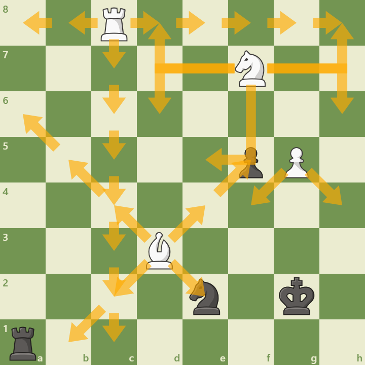
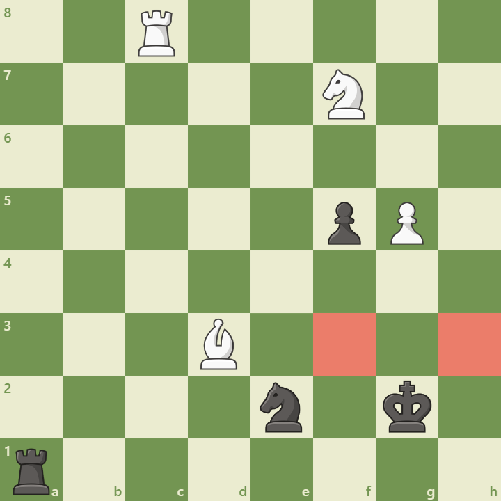
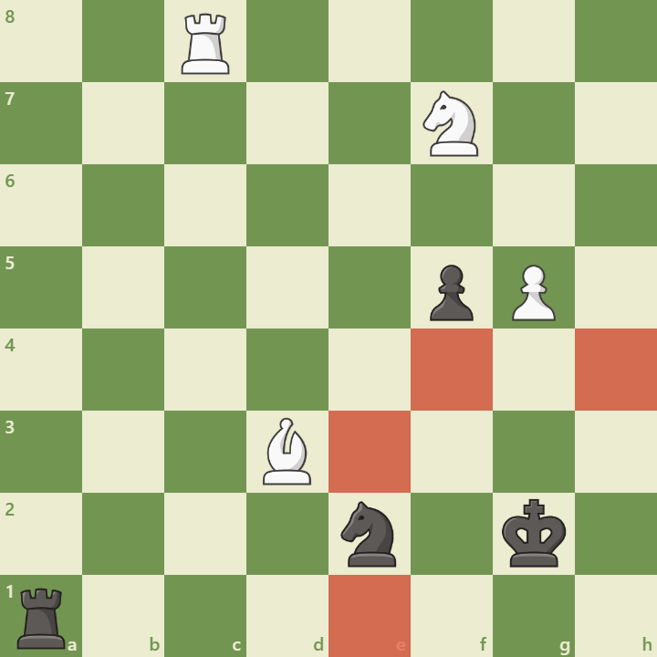
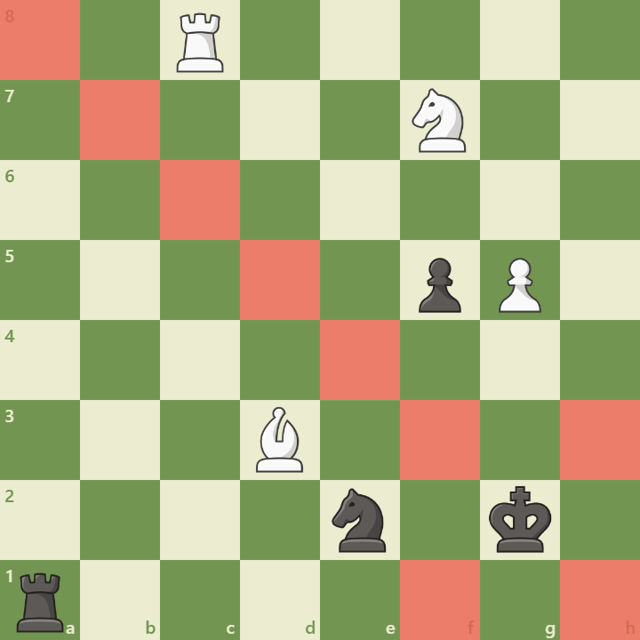
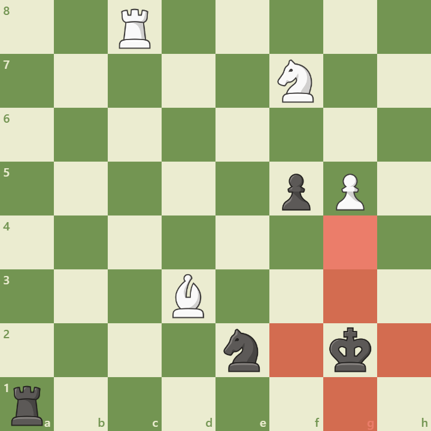

# Move generation — MultiPLY v1.0

[README](../README.md) · [Architecture](architecture.md) · [Engine](engine.md) · [Diagnostics](diagnostics.md)

MultiPLY generates legal moves by combining precomputed board geometry with occupancy checks and a temporary king-safety test. The same generator serves play, notation resolution, search, and perft, so those features agree on which moves a position permits.

The implementation uses a 64-square array, not bitboards. It generates candidates one at a time, tests them immediately, and writes accepted moves directly into a fixed-capacity list. There is no separate stored list of every pseudo-legal move.

## From a position to legal moves

```text
position + generation mode
    -> scan the side to move's pieces
    -> look up movement targets/rays
    -> check occupancy and special-move conditions
    -> temporarily make each candidate
    -> reject it if the moving side's king is attacked
    -> restore the board and append accepted moves
    -> append separately validated castling moves in All mode
```

A **pseudo-legal candidate** obeys the piece's movement and occupancy rules but might leave its own king in check. A **legal move** also passes king safety. An **attack query** asks whether a particular color attacks a square; it does not generate that color's legal move list. Keeping these concepts distinct matters for pinned pieces, king moves, and castling.

## Precomputed movement geometry

Squares are indexed from `a1 = 0` through `h8 = 63`, with `index = rank * 8 + file` using zero-based rank/file coordinates. Movement tables are constructed at compile time. Board-edge checks happen during table construction, so runtime traversal receives only squares on the board.

| Piece or move | Stored geometry | Runtime checks |
| --- | --- | --- |
| Pawn captures | Up to two diagonal targets per color and square | Enemy occupancy or the current en passant target; promotion rank. |
| Pawn single push | One forward square per color where on-board | Empty target; promotion rank. |
| Pawn double push | Intermediate/target squares, available only from the starting rank | Both squares empty. |
| Knight | Up to eight jump targets | Destination occupancy. |
| King | Up to eight adjacent targets | Destination occupancy, then king safety. |
| Bishop | Four diagonal rays, each ordered nearest to farthest | Traverse until the first occupied square. |
| Rook | Four orthogonal rays, each ordered nearest to farthest | Traverse until the first occupied square. |
| Queen | Bishop and rook rays together | The same sliding-piece checks. |

Tables encode geometry, not current attacks or legal moves. They do not change when a piece moves; occupancy, color, and king safety are evaluated against the current position.

## Attack detection: start at the target square

To test whether a king is safe, the engine needs a yes/no answer for one square. One possible approach is to trace attacks outward from every opposing piece, as illustrated below.



*Forward tracing illustrates how many attack paths can be explored when starting from the attacking pieces. This is a conceptual comparison; the current attack detector starts from the square being tested.*

The current query is `is_attacked_square(position, square, attacking_color)`. It works outward from `square`, checking only locations from which the specified color could attack it. It returns as soon as an attacker is found. The following diagrams use the black king on **g2** as the target. They illustrate geometry and blockers, rather than supplying a complete legal test position.

### Pawn sources

Pawn attacks are directional. To find attacking pawn origins, the detector uses the **opposite color's pawn-attack table at the target square**, then checks those squares for pawns of the requested attacking color.



*For attacks by White on g2, inspect f3 and h3 for white pawns. Pawn pushes are never used in attack detection, and an empty diagonal square can still be attacked.*

### Knight and king sources

Knight movement is symmetric: every square a knight could jump to from the target is also a possible origin of a knight attacking it. The detector checks the precomputed knight targets for the requested color's knights.



*Highlighted squares are possible knight origins, not confirmed attacks. A bishop on a highlighted square does not count as a knight attacker. Board-edge filtering removes off-board candidates.*

Enemy king adjacency uses the same idea with the king-movement table. A king attacks its adjacent squares even when moving there would be illegal for that king; the attack query does not recursively test the attacker's king safety.

### Diagonal rays

From the target, the detector walks each diagonal outward. A bishop or queen of the attacking color establishes an attack. Any other occupied square blocks the rest of that ray, regardless of color.



*Diagonal squares are checked nearest first. A bishop or queen beyond the first occupied square cannot attack through that blocker. The engine stops immediately if the first occupied square is a matching attacker.*

### Orthogonal rays

Ranks and files use the same procedure, looking for attacking rooks or queens.



*The knight on f2 blocks the westward ray, while the pawn on g5 blocks the northward ray. Neither is a rook or queen, so neither establishes an orthogonal attack. Squares beyond either blocker need no inspection.*

The query checks pawn, knight, king, diagonal, then orthogonal attacks. It does not build a persistent attack map or scan every opposing piece. Pinned attackers still count geometrically: determining whether a king may occupy a square does not require the attacking piece to have a legal move that captures the king.

## Candidate generation by piece

For knights and kings, an empty destination produces a quiet move in `All` mode; an enemy-occupied destination produces a capture. Friendly-occupied destinations are skipped.

Sliding pieces walk their rays in order. An empty square can produce a quiet move, then traversal continues. The first enemy piece can be captured, ending the ray. A friendly piece ends the ray without producing a move. Queens traverse diagonal rays before orthogonal rays.

Pawns check diagonal captures and en passant first, then the single push and the starting-rank double push. A double push requires an empty intermediate square as well as an empty target. Reaching the final rank generates four separate promotion candidates: knight, bishop, rook, and queen. Both capturing and non-capturing promotions are supported.

Every ordinary candidate passes through the same king-safety filter before it enters the output list. Promotions are tested independently even when their resulting king-safety outcome is the same.

## Legal filtering and temporary board changes

For each candidate, the filter remembers the captured piece, determines the moving king's resulting square, and temporarily changes piece placement. It then asks whether the opponent attacks that king square and restores the board before returning its answer.

This test uses lightweight make/unmake operations: they change board occupancy, including promotion, en passant removal, and castling rook movement, but leave side to move, counters, rights, and cached king locations unchanged. A king move therefore supplies its destination explicitly to the attack query. This avoids updating unrelated position metadata for each candidate.

Search and perft use the fuller apply/revert operations when descending into a child position. Those also update side to move, castling rights, en passant state, move counters, and cached king locations, returning the undo information needed to restore them. The distinction is between testing a candidate's immediate king safety and entering a complete child position.

This filtering handles pins, discovered checks, blocking a check, capturing a checking piece, and king escapes without separate pin masks or a dedicated check-evasion generator. Its cost is a temporary board mutation and an attack query for every candidate. The low-level filter assumes a candidate already obeys movement and occupancy rules; it is not a standalone validator for arbitrary encoded moves.

## Special moves

### En passant

A pawn diagonal matching the current en passant target produces an en passant candidate. Its temporary move removes the captured pawn from the adjacent square, rather than from the destination. King safety is checked on that resulting board, then both pawns are restored.

Removing both pawns from their original rank can uncover a rook or queen attack on the moving side's king. Testing the full resulting occupancy is what rejects that otherwise plausible en passant capture. When a double push is actually applied, the position records the intermediate square as the next en passant target; other applied moves clear it.

### Promotions

Promotion replaces the pawn with the selected piece on the destination. The move encoding distinguishes ordinary promotions from promotion captures. Unmaking the candidate restores a pawn on its origin and restores any captured piece. Tactical generation includes quiet promotions as well as promotion captures.

### Castling

Castling is appended separately after ordinary moves, only in `All` mode. It requires the corresponding castling right, an empty path, and no attack on the king's starting, transit, or destination square.

| Side | Squares that must be empty | King squares that must be safe |
| --- | --- | --- |
| White kingside | f1, g1 | e1, f1, g1 |
| White queenside | b1, c1, d1 | e1, d1, c1 |
| Black kingside | f8, g8 | e8, f8, g8 |
| Black queenside | b8, c8, d8 | e8, d8, c8 |

Queenside b1/b8 must be empty but need not be safe for the king. Castling relies on consistent position rights and piece placement: normal position updates revoke rights after king/rook moves and corner-rook captures, and FEN loading checks the king/rook placement associated with supplied rights. The castling test itself does not revalidate every position invariant. These are standard-chess castling rules; Chess960 castling is not implemented.

## All and Tactical generation

| Mode | Moves included |
| --- | --- |
| `MoveGeneration::All` | Every legal quiet move, capture, pawn push, promotion, en passant capture, and permitted castle. |
| `MoveGeneration::Tactical` | Legal captures, en passant captures, promotion captures, and non-capturing promotions. |

Tactical mode still traverses empty sliding-ray squares to reach possible captures, but does not emit those quiet moves. It omits ordinary quiet checks and quiet evasions, so it is not a complete check-evasion generator. It is also not quiescence search: v1 search uses `All` and evaluates leaves directly. The tactical subset is available to callers as a generation option.

## Output, ordering, and limits

`generate_all_moves(output, position, mode)` clears and refills a caller-provided list. `all_moves(position, mode)` returns a newly populated list by value. Successful generation leaves the position unchanged. Both require a valid, internally consistent position and temporary mutable access while filtering candidates.

Each list holds up to **256 encoded moves** in fixed storage. A move occupies two bytes and records origin, target, and move kind. The reusable search/perft stack supplies a separate list for each of **16 plies**. These fixed capacities avoid a heap allocation for each generated move list; they are implementation limits, not dynamically expanding containers.

Generation order follows the board scan from a1 through h8, then each piece's table order. Pawn promotion choices are emitted knight, bishop, rook, then queen. Castling is appended kingside then queenside when available. No capture scoring or search-based sorting is performed. This order matters to the [engine baseline](engine.md), which searches moves as generated; it does not imply a chess preference.

## Validation and performance

Perft exercises generation and complete apply/revert across the legal move tree. A root divide helps isolate a discrepancy to one move; preset suites compare counts across positions with different special-move and king-safety situations.

```text
position --startpos
perft test --depth 3
perft test --preset fast
```

The initial position has 20 legal moves and 8,902 depth-3 leaves. `debug --depth N` compares divides and resulting positions against an external Stockfish process, while `perft benchmark` measures traversal throughput. See [Diagnostics](diagnostics.md) for setup, expected-count selection, and report handling.

The present design favors reusable geometry, direct emission, and a shared legality test. It does not cache attack maps, derive pins/checkers in advance, or use bitboard sliding-attack lookup schemes. Any future optimization must preserve blocker handling, restoration of temporary changes, and special-move king safety across both generation modes.
